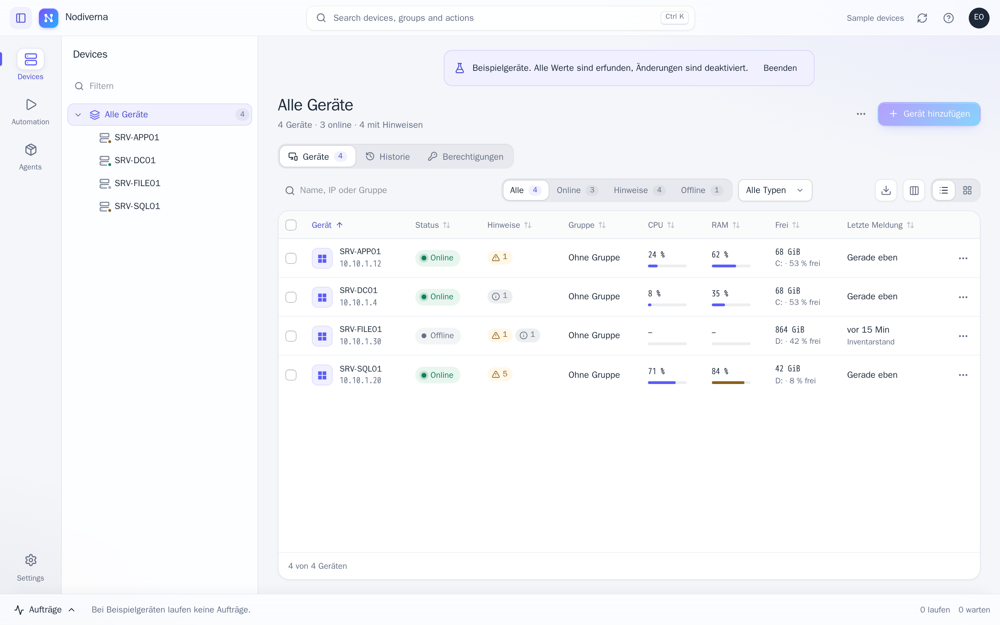
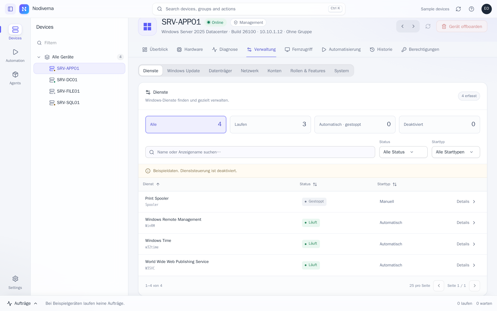

<p align="center">
  
</p>

<h1 align="center">Nodiverna</h1>

<p align="center">Self-hosted management portal for your servers and PCs.</p>

<p align="center">
  <a href="https://github.com/nodiverna/nodiverna/actions/workflows/docker-image.yml"></a>
  <a href="https://github.com/nodiverna/nodiverna/pkgs/container/nodiverna"></a>
  <a href="LICENSE"></a>
</p>

<p align="center">
  <a href="#quick-start">Quick start</a> · <a href="#features">Features</a> · <a href="#supported-operating-systems">Supported systems</a> · <a href="#documentation">Documentation</a> · <a href="#license">License</a>
</p>

<picture>
  <source media="(prefers-color-scheme: dark)" srcset="ServerDesk/docs/images/readme-fleet-dark.png">
  
</picture>

Nodiverna is a web portal to monitor and manage your servers and PCs. An agent on each device sends data and does authorized jobs, and it makes only outgoing HTTPS connections. You operate the portal yourself with one Docker image. The code, the folder `ServerDesk/` and the Docker volumes use the internal name ServerDesk.

## Features

- **Fleet overview.** The portal shows all devices in one list, with their status and load. You can put devices into groups and subgroups.
- **Monitoring and hardware inventory.** The agent sends CPU, memory, disks and network data. The portal also shows the hardware of each device.
- **Diagnostics.** You can examine the processes, sessions, events and network connections of a device.
- **Windows management.** You can control services, updates, disks, network, accounts, and roles and features. These actions are available only when the device is in Management mode.
- **Remote access.** You can use the file browser and an interactive terminal in the browser. Remote Desktop is in development at this time, and the portal blocks it.
- **Automation.** Runbooks run steps manually or on a schedule. Desired State sets the target configuration, and the drift check finds configuration drift.
- **Access control.** Nodiverna has its own accounts with a password and MFA, with an authenticator app or a passkey. You assign roles to the full portal, to device groups or to single devices.
- **Customers.** One portal manages several customers. Each customer has its own devices, groups, technician access, installers and audit entries.
- **Self-hosting.** One Docker image runs on a NAS, on your own server and on Azure.

## Supported operating systems

The agent runs on these 64-bit (x64) operating systems:

| Operating system | Status |
|---|---|
| Windows Server 2025 | Supported |
| Windows Server 2022 | Supported |
| Windows 11 Pro and Enterprise | Supported |
| Ubuntu | Planned |
| Debian | Planned |

The portal itself runs as a Docker image on Linux (`linux/amd64`), see [Quick start](#quick-start).

## Screenshots


*The sample server `SRV-APP01` in the area **Overview**, with its load, history and notes.*



*The four Windows services of `SRV-APP01` in the area **Management**, subtab **Services**.*

The screenshots show sample devices. All values are fictional.

## Quick start

You need Docker Compose 2.23.1 or later. At this time, the image is available only for `linux/amd64`. You do not need a checkout, a build or Node.js on the host.

1. Download `compose.yaml` and the template for the environment file into an empty directory:

   ```sh
   mkdir nodiverna && cd nodiverna
   curl -fsSLO https://raw.githubusercontent.com/nodiverna/nodiverna/main/ServerDesk/compose.yaml
   curl -fsSLO https://raw.githubusercontent.com/nodiverna/nodiverna/main/ServerDesk/deploy/runtime.env.example
   ```

2. Make the file `.env.runtime` and generate the secrets. The command uses the Node.js in the image:

   ```sh
   grep -v -E '^(SESSION_SECRET|PASSWORD_PEPPER|AGENT_JOB_SIGNING_KEY|DATABASE_PASSWORD)=' runtime.env.example > .env.runtime
   docker run --rm --entrypoint node ghcr.io/nodiverna/nodiverna:latest -e "const c=require('crypto'),r=()=>c.randomBytes(48).toString('base64url');console.log('SESSION_SECRET='+r()+'\nPASSWORD_PEPPER='+r()+'\nDATABASE_PASSWORD='+c.randomBytes(24).toString('hex')+'\nAGENT_JOB_SIGNING_KEY='+c.generateKeyPairSync('ec',{namedCurve:'prime256v1'}).privateKey.export({type:'pkcs8',format:'der'}).toString('base64'))" >> .env.runtime
   chmod 600 .env.runtime
   ```

   Then write the address into `.env.runtime`. `SITE_ORIGIN` is exactly the address in the browser, with the port and without a slash at the end. For a device in the LAN at `192.168.1.10`, set these values: `SITE_ORIGIN=https://192.168.1.10:8443`, `CADDY_ADDRESS=https://192.168.1.10` and `CADDY_SERVER_NAME=192.168.1.10`.

3. Download the image:

   ```sh
   docker compose --env-file .env.runtime pull
   ```

4. Migrate the database. Compose starts the PostgreSQL service `db` first:

   ```sh
   docker compose --env-file .env.runtime run --rm app node scripts/selfhost.mjs migrate
   ```

5. Start the portal:

   ```sh
   docker compose --env-file .env.runtime up -d
   ```

6. Make the first owner. Open the invitation link from the output within 24 hours:

   ```sh
   docker compose --env-file .env.runtime run --rm app node scripts/selfhost.mjs bootstrap-owner --username admin --display-name Administrator
   ```

For HTTPS with the local Caddy CA, backups, updates and image tags, read [Run with Docker Compose](ServerDesk/docs/self-hosting.md#run-with-docker-compose).

## Run from source

Install Node.js 22.13 or later and pnpm 11.25.0. Then run these commands in the root directory of the repository:

```powershell
cd ServerDesk
node scripts/pipeline.mjs install
pnpm setup
pnpm db:migrate
pnpm owner:bootstrap --username admin --display-name Administrator
pnpm dev
```

Open the invitation link from the output, set the password and configure MFA. The user interface is at `https://localhost:3000`. Your browser must trust the development certificate.

```powershell
node scripts/pipeline.mjs verify
```

The pipeline checks the types, lint and tests. It also makes the production build and runs the HTTP integration checks. [Installation and operation](ServerDesk/docs/self-hosting.md) tells you about the setup, Docker, NAS and Azure. GitHub Actions ([ci.yml](.github/workflows/ci.yml)) runs the same checks on each push to `dev` and on each pull request.

## Register a Windows device

The agent supports Windows Server 2022/2025 and Windows 11 Pro/Enterprise. In the portal, open **Add device** to get the agent EXE, the registration file and the instructions. Agent updates use signed packages, and the ReadOnly and Management modes control which actions the device permits. For more information, read [Windows agent](ServerDesk/agent/v3/README.md).

## Documentation

- [Installation and operation](ServerDesk/docs/self-hosting.md): Docker Compose, NAS, Azure, HTTPS, backups and updates.
- [Windows agent](ServerDesk/agent/v3/README.md): installation, modes and updates of the agent.
- [Device areas](ServerDesk/docs/device-workspace.md): the areas of a device and their tools.
- [Device groups](ServerDesk/docs/device-groups.md): groups, subgroups and the rights that they give.
- [Automation](ServerDesk/docs/automation.md): runbooks, schedules, Desired State and drift.
- [Own login and RBAC](ServerDesk/docs/local-identity-rbac.md): accounts, invitations, MFA and roles.
- [Customers](ServerDesk/docs/customers.md): several customers in one portal, the customer boundary, installers and actions for several customers.
- [Usage data](ServerDesk/docs/usage-data.md): which technical values the portal can send, and only with your consent.
- [Wiki](https://github.com/nodiverna/nodiverna/wiki): the same documentation as wiki pages with a sidebar.
- [Releases](https://github.com/nodiverna/nodiverna/releases): the versions of the image and the agent, with their changes.

## Contributing and security

Read [`CONTRIBUTING.md`](CONTRIBUTING.md) before you open a pull request. We merge a contribution only when you submit it under the contribution terms in that file.

Do not report a vulnerability as a public issue. Report it in private, as [`SECURITY.md`](SECURITY.md) tells you.

## License

The whole repository uses the GNU Affero General Public License, version 3 only (AGPL-3.0, refer to [`LICENSE`](LICENSE)). This includes the customer functions. The product stays free of charge on GitHub, and the Docker image `ghcr.io/nodiverna/nodiverna` contains the complete product.

Contributions use the same license, as the contribution terms in [`CONTRIBUTING.md`](CONTRIBUTING.md) tell you.

Third-party components keep their own licenses, for example the components that [`ServerDesk/agent/v3/THIRD-PARTY-NOTICES.txt`](ServerDesk/agent/v3/THIRD-PARTY-NOTICES.txt) lists.

The manufacturer logos come from Simple Icons (CC0-1.0) and are trademarks of their owners, refer to [`ServerDesk/docs/manufacturer-logos.md`](ServerDesk/docs/manufacturer-logos.md).
