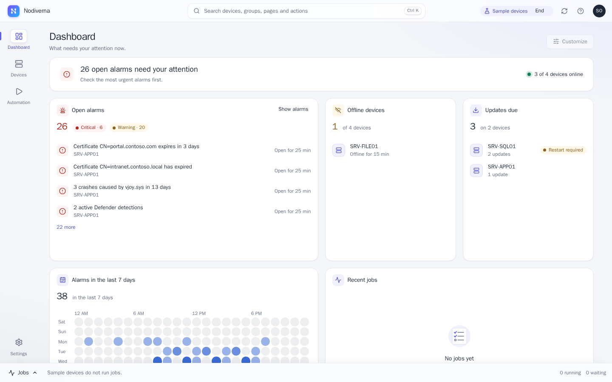
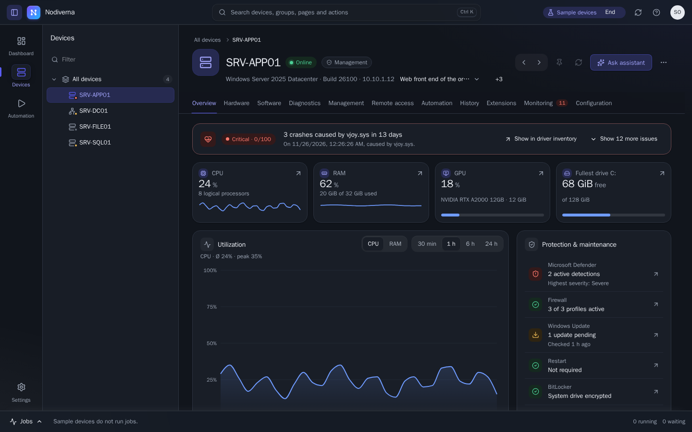

<p align="center">
  
</p>

<h1 align="center">Nodiverna</h1>

<p align="center">Self-hosted management portal for your servers and PCs.</p>

<p align="center">
  <a href="https://github.com/nodiverna/nodiverna/actions/workflows/docker-image.yml"></a>
  <a href="https://github.com/nodiverna/nodiverna/pkgs/container/nodiverna"></a>
  <a href="LICENSE"></a>
</p>

<p align="center">
  <a href="#quick-start">Quick start</a> · <a href="#features">Features</a> · <a href="#screenshots">Screenshots</a> · <a href="#documentation">Documentation</a> · <a href="#license">License</a>
</p>

<picture>
  <source media="(prefers-color-scheme: dark)" srcset="ServerDesk/docs/images/readme-fleet-dark.png">
  
</picture>

Nodiverna is a self-hosted web portal to monitor and manage your servers and PCs. An agent on each device sends data and does authorized jobs, and it makes only outgoing HTTPS connections. You operate the portal yourself with one Docker image. The code, the folder `ServerDesk/` and the Docker volumes use the internal name ServerDesk.

## Features

- Fleet overview: all devices in one list with their status and load, in groups and subgroups.
- Monitoring and diagnostics: CPU, memory, disks, network, hardware inventory, processes, events and network connections.
- Windows management: services, updates, disks, accounts, and roles and features, when the device is in Management mode.
- Remote access: a file browser and an interactive terminal in the browser.
- Automation: runbooks on demand or on a schedule, Desired State and a drift check.
- Accounts and customers: own accounts with MFA, roles for the portal, groups or devices, and several customers in one portal.
- Agent platforms: Windows Server 2022 and 2025, Windows 11 Pro and Enterprise (x64). Ubuntu and Debian are planned.

## Screenshots



*The **Dashboard** shows what needs your attention now.*



*The sample server `SRV-APP01` in the area **Overview**, in dark mode.*

The screenshots show sample devices. All devices and values are fictional.

## Quick start

You need Docker with Compose 2.23.1 or later on a `linux/amd64` host, and no checkout, build or Node.js.

1. Download the quick-start file into an empty directory:

   ```sh
   mkdir nodiverna && cd nodiverna
   curl -fsSLO https://raw.githubusercontent.com/nodiverna/nodiverna/main/ServerDesk/deploy/quickstart/compose.yaml
   ```

2. Generate the secrets into the file `.env`. Do this only one time, because the database keeps its first password:

   ```sh
   docker run --rm ghcr.io/nodiverna/nodiverna:latest node scripts/selfhost.mjs secrets > .env
   chmod 600 .env
   ```

   For access from other devices, add the line `PORTAL_HOST=<address>` to `.env`, for example `PORTAL_HOST=192.168.1.10`.

3. Start the portal. Compose downloads the images, prepares the database and starts the portal at `https://localhost:8443` (or `https://<PORTAL_HOST>:8443`):

   ```sh
   docker compose up -d
   ```

   The first time, the browser warns you about the local certificate.

4. Make the first owner:

   ```sh
   docker compose exec app node scripts/selfhost.mjs bootstrap-owner --username admin --display-name Administrator
   ```

   Open the invitation link from the output within 24 hours. Then set the password and MFA.

To update, run `docker compose pull` and then `docker compose up -d`. The database update and its backup run automatically. For a public DNS name, other ports, fixed versions, backups and trust in the local certificate on Windows devices, read [Run with Docker Compose](ServerDesk/docs/self-hosting.md#run-with-docker-compose).

## Documentation

- [Installation and operation](ServerDesk/docs/self-hosting.md): Docker Compose, NAS, Azure, HTTPS, backups and updates.
- [Windows agent](ServerDesk/agent/v3/README.md): installation, modes, updates and the registration of a device with **Add device**.
- [Develop and test locally](ServerDesk/docs/self-hosting.md#develop-and-test-locally): run the portal from source and run the checks.
- [Security](SECURITY.md): how to report a vulnerability.
- [Device areas](ServerDesk/docs/device-workspace.md): the areas of a device and their tools.
- [Device groups](ServerDesk/docs/device-groups.md): groups, subgroups and the rights that they give.
- [Automation](ServerDesk/docs/automation.md): runbooks, schedules, Desired State and drift.
- [Own login and RBAC](ServerDesk/docs/local-identity-rbac.md): accounts, invitations, MFA and roles.
- [Customers](ServerDesk/docs/customers.md): several customers in one portal, with their own devices, installers and access.
- [Usage data](ServerDesk/docs/usage-data.md): which technical values the portal can send, and only with your consent.
- [Releases](https://github.com/nodiverna/nodiverna/releases): the versions of the image and the agent, with their changes.

## Contributing and security

Read [`CONTRIBUTING.md`](CONTRIBUTING.md) before you open a pull request. We merge a contribution only when you submit it under the contribution terms in that file. Do not report a vulnerability as a public issue, but in private as [`SECURITY.md`](SECURITY.md) tells you.

## License

The whole repository uses the GNU Affero General Public License, version 3 only (AGPL-3.0, refer to [`LICENSE`](LICENSE)). Contributions use the same license, as the contribution terms in [`CONTRIBUTING.md`](CONTRIBUTING.md) tell you.

Third-party components keep their own licenses, for example the components in [`ServerDesk/agent/v3/THIRD-PARTY-NOTICES.txt`](ServerDesk/agent/v3/THIRD-PARTY-NOTICES.txt).

The manufacturer logos come from Simple Icons (CC0-1.0) and are trademarks of their owners, refer to [`ServerDesk/docs/manufacturer-logos.md`](ServerDesk/docs/manufacturer-logos.md).
